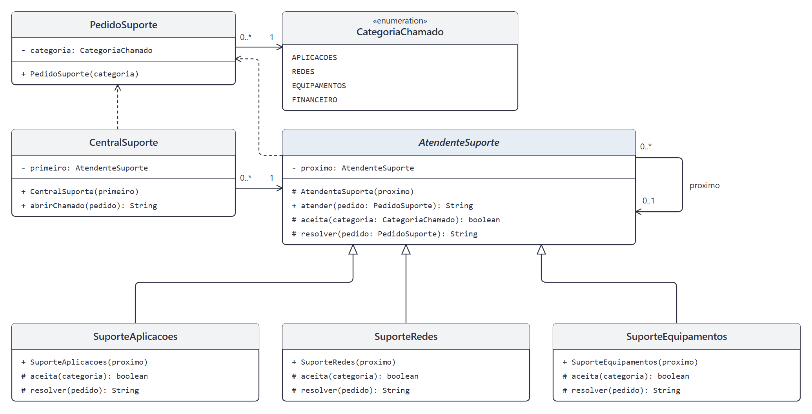

# DCC078 - Padrões de Projeto: Chain of Responsibility

**Aluno:** Felipe Lazzarini Cunha

## Tema

O projeto representa uma central de suporte de TI que encaminha chamados entre atendentes de aplicações, redes e equipamentos. O Chain of Responsibility permite que cada atendente resolva o pedido de sua categoria ou o repasse ao próximo da cadeia. O atendimento é simulado por mensagens de texto, com retorno específico quando nenhum atendente aceita a categoria.

## Diagrama de Classes UML



## Estrutura do Projeto

- `PedidoSuporte` e `CategoriaChamado`: representam o pedido e sua categoria.
- `AtendenteSuporte`: abstração que mantém o próximo atendente e controla o encaminhamento.
- `SuporteAplicacoes`, `SuporteRedes` e `SuporteEquipamentos`: atendentes concretos responsáveis por suas categorias.
- `CentralSuporte`: cliente que recebe os pedidos e inicia o atendimento pela cadeia configurada.

## Testes

Com JDK 11 ou superior e Maven:

```bash
mvn test
```
